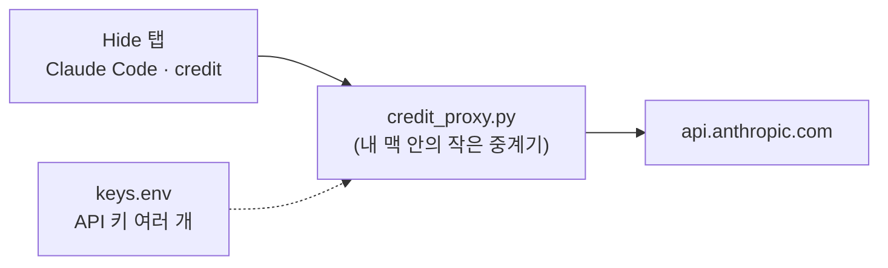

# Claude Max 월간 API 크레딧을 Hide에서 쓰기

> **비공식 방법입니다.**
> Anthropic이 지원하는 사용법이 아니고, Hide의 공식 기능도 아닙니다.
> Anthropic이 언제든 막을 수 있고, 약관 위반으로 볼 수도 있습니다.
> 쓸지 말지는 본인이 판단하고, 책임도 본인이 집니다.

**English summary:** Max and Team plans come with monthly API credit that the Claude Code terminal refuses (`Credit balance too low`).
This folder holds a small local launcher that starts the normal Claude Code terminal so the credit applies, switches between several API keys when one runs out, and plugs into [Hide](https://withhide.dev) as an agent profile.
Unofficial, unsupported, and possibly against the provider's terms; use at your own risk.

## 무엇이 되나요

Claude Max 같은 요금제는 매달 API 크레딧을 줍니다(예: $200).
그런데 이 키를 평소 쓰는 Claude Code 터미널에 넣으면 이렇게 거절됩니다.

```
Credit balance too low
```

이 크레딧은 Agent SDK나 API 같은 곳에서만 쓰도록 되어 있고, Claude Code 터미널은 거기에 들어가지 않기 때문입니다.
([공식 안내](https://support.claude.com/en/articles/17154008-monthly-api-credits-for-max-ultra-and-team-plans))

이 폴더의 실행기를 쓰면 **평소와 똑같은 Claude Code 화면**이 그 크레딧으로 돌아갑니다.
Hide에서는 `Claude Code · credit` 같은 프로필 하나로 고를 수 있습니다.



## 어떻게 되는 건가요

같은 버전, 같은 키로 비교한 결과입니다(Claude Code 2.1.318, Haiku).

| Claude Code가 자기를 소개하는 방식 | 결과 |
| --- | --- |
| 평소처럼 터미널(`CLAUDE_CODE_ENTRYPOINT=cli`) | `Credit balance too low` |
| SDK(`CLAUDE_CODE_ENTRYPOINT=sdk-ts`) | 정상 응답, 이어서 묻고 파일 도구 쓰는 것까지 됨 |

실행기가 하는 일은 네 가지입니다.

1. Claude Code를 `CLAUDE_CODE_ENTRYPOINT=sdk-ts`로 띄웁니다.
   이것이 이 방법이 비공식인 이유입니다.
2. 내 맥 안(`127.0.0.1`)에만 열리는 중계기를 띄우고, Claude Code가 그 중계기를 거쳐 `api.anthropic.com`에 가게 합니다.
   Claude Code에는 진짜 키 대신 중계기용 키(`sk-ant-proxy-…`)만 보입니다.
3. 키가 여러 개면, 잔액이 떨어지거나 한도에 걸린 키를 건너뛰고 다음 키로 넘어갑니다.
4. 구독 로그인 토큰 변수(`CLAUDE_CODE_OAUTH_TOKEN` 등)는 Claude Code에 넘기지 않습니다.

## 준비물

- macOS 또는 Linux (macOS에서만 확인했습니다. Windows는 지원하지 않습니다.)
- Python 3.9 이상 (macOS 기본 `/usr/bin/python3`로 충분합니다. 추가 패키지는 없습니다.)
- Claude Code (`claude`가 PATH에 있어야 합니다.)
- [Hide](https://withhide.dev)
- [Claude Console](https://console.anthropic.com)에서 만든 API 키

## 설치

### 1. 내려받기

```sh
git clone https://github.com/yansfil/hide-tricks ~/hide-tricks
```

### 2. 키 파일 만들기

```sh
mkdir -p ~/.config/claude-api-credit
cp ~/hide-tricks/claude-max-credit/keys.env.example ~/.config/claude-api-credit/keys.env
chmod 600 ~/.config/claude-api-credit/keys.env
```

`~/.config/claude-api-credit/keys.env`를 열어 키를 넣습니다.

```dotenv
ANTHROPIC_API_KEY_1=sk-ant-api03-...
ANTHROPIC_API_KEY_2=
```

키는 하나만 넣어도 됩니다.
제대로 들어갔는지 봅니다(키 값은 화면에 나오지 않습니다).

```sh
~/hide-tricks/claude-max-credit/credit_proxy.py keys check
```

### 3. Hide 프로필 만들기

이 프로필 전용 Claude Code 계정 폴더를 만듭니다.
평소 쓰는 `~/.claude`와 대화 기록, 설정, 승인 기록이 섞이지 않게 하려는 것입니다.

```sh
mkdir -p ~/.claude-credit
```

Hide 탭의 터미널에서 프로필을 추가합니다.

```sh
hide agent profile add claude-code credit \
  --account ~/.claude-credit \
  --program ~/hide-tricks/claude-max-credit/credit_proxy.py
```

`hide`가 PATH에 없으면 `/Applications/hide.app/Contents/Resources/hide`로 실행합니다.
화면에서 하려면 **설정 › 에이전트 › Claude Code › 프로필 추가**에서 같은 값을 넣습니다.

| 칸 | 값 |
| --- | --- |
| 이름 | `credit` |
| 계정 폴더 | `~/.claude-credit` |
| 대신 실행할 프로그램 | `~/hide-tricks/claude-max-credit/credit_proxy.py` |
| 환경 변수 | 비워 둡니다. 키는 여기에 넣지 않습니다. |

Hide가 이 폴더에 자기 훅과 스킬을 알아서 설치합니다.

### 4. 처음 한 번 띄우기

Hide의 새 탭에서 에이전트로 **Claude Code · credit**을 고릅니다.
새 계정 폴더라서 처음 한 번은 Claude Code가 몇 가지를 묻습니다.

1. 테마 고르기: Enter
2. `Detected a custom API key in your environment` / `Do you want to use this API key?`
   기본 선택이 `No`이므로 **위 화살표로 `Yes`를 고르고 Enter**를 누릅니다.
   여기 보이는 `sk-ant-proxy-…`는 내 맥 안 중계기용 키이고, 진짜 키가 아닙니다.
3. 보안 안내: Enter

시작 화면에 **`API Usage Billing`**이 보이면 크레딧으로 돌아가는 것입니다.

```
 ▐▛███▛█   Claude Code v2.1.325
▝▜██████▀  Haiku 5.5 · API Usage Billing
```

이 질문들은 계정 폴더마다 한 번뿐입니다.
그 뒤로는 새 탭, 다시 열기, `hide agent spawn --profile credit`, 미션 작업자 모두 묻지 않고 바로 시작합니다.

### 같이 쓰고 싶은 설정이 있다면 (선택)

평소 쓰는 전역 지침을 이 프로필에서도 쓰려면 링크를 걸어 둡니다.

```sh
ln -s ~/.claude/CLAUDE.md ~/.claude-credit/CLAUDE.md
```

## 키 여러 개 자동 전환

`keys.env`에 `ANTHROPIC_API_KEY_1`, `_2`, `_3`처럼 번호를 붙여 최대 64개까지 넣을 수 있습니다.

| 이런 일이 생기면 | 이렇게 합니다 |
| --- | --- |
| 응답이 잘 오면 | 그 키를 계속 씁니다. |
| 잔액 부족 | 그 키를 1시간 쉬고 다음 키로 다시 보냅니다. |
| 한도 초과(429) | `Retry-After`만큼(1초에서 1시간, 없으면 60초) 쉬고 다음 키로 다시 보냅니다. |
| 인증 실패(401) | 이번 실행 동안 그 키를 뺍니다. |
| 답이 이미 나오기 시작한 뒤 오류 | 같은 요청을 다시 보내지 않습니다. 다음 요청부터 다른 키를 씁니다. |
| 연결이 끊겨 처리됐는지 모를 때 | 다시 보내지 않습니다. 같은 작업이 두 번 돌지 않게 하려는 것입니다. |
| 모든 키가 거절 | 키마다 한 번씩만 해 보고 오류를 돌려줍니다. |

`keys.env`를 고치면 다음 요청부터 바로 반영됩니다.
같은 조직에 속한 키들은 잔액과 한도를 함께 쓰므로, 키 개수를 늘린다고 쓸 수 있는 양이 늘지는 않습니다.

## 기록과 문제 해결

진단 기록은 `~/.local/state/claude-api-credit/proxy.jsonl`에 남습니다.
요청 ID, 키 이름(`ANTHROPIC_API_KEY_1` 같은 이름만), HTTP 상태, 걸린 시간만 적고, 키 값이나 대화 내용은 적지 않습니다.
2 MiB 파일 세 개를 넘지 않습니다.

| 증상 | 확인할 것 |
| --- | --- |
| `Credit balance too low`가 그대로 나옴 | 시작 화면에 `API Usage Billing`이 보이는지, Hide에서 `credit` 프로필을 골랐는지 봅니다. Anthropic이 이 방법을 막았을 수도 있습니다. |
| 시작할 때마다 API 키를 물어봄 | `~/.local/state/claude-api-credit/local-token`이 지워지지 않았는지 봅니다. 이 파일이 중계기용 키라서, 바뀌면 다시 묻습니다. |
| `Key file must be owned by you with mode 600` | `chmod 600 ~/.config/claude-api-credit/keys.env` |
| `Claude Code not found` | `claude`를 PATH에 두거나 `CLAUDE_CREDIT_CLAUDE`에 실행 파일의 절대 경로를 넣습니다. |
| 응답이 중간에 끊김 | `proxy.jsonl`에서 `upstream.response`의 `status`와 `key.rejected`를 봅니다. |

요청 하나는 최대 5분, 실행 하나는 최대 24시간, 동시 요청은 최대 8개로 제한됩니다.
코드를 고쳤다면 이미 열린 탭은 옛 코드로 돌고 있으니, 탭을 닫고 다시 띄워야 합니다.

## Hide 밖에서 쓰기

터미널에서 바로 띄워도 됩니다.
Claude Code에 주는 인자는 그대로 전달됩니다.

```sh
ln -s ~/hide-tricks/claude-max-credit/credit_proxy.py ~/.local/bin/claude-api-credit
claude-api-credit              # 새 대화
claude-api-credit --continue   # 이어서
```

이렇게 띄우면 평소 쓰는 `~/.claude` 계정 폴더를 씁니다.
따로 쓰려면 `CLAUDE_CONFIG_DIR=~/.claude-credit claude-api-credit`처럼 띄웁니다.
처음 여는 폴더에서는 `Is this a project you created or one you trust?`를 묻는데, 기본 선택이 `No, exit`이므로 아래 화살표로 `Yes, I trust this folder`를 고릅니다.
Hide에서 띄우면 Hide가 이 질문을 미리 처리해서 나오지 않습니다.

## 지우기

```sh
hide agent profile remove claude-code credit
rm -rf ~/.claude-credit ~/.local/state/claude-api-credit ~/.config/claude-api-credit ~/hide-tricks
```

## 확인한 것

- Hide에서 `credit` 프로필로 Claude Code 2.1.325를 띄워 실제 API로 답을 받았고, Hide가 그 에이전트를 `Claude · credit` 프로필로 등록했습니다(2026-11-14, macOS).
- 같은 계정 폴더로 다시 띄웠을 때 API 키를 묻지 않고 바로 `API Usage Billing`으로 시작했습니다.
- 자동 테스트 19개(가짜 키와 가짜 서버 사용, 크레딧을 쓰지 않음): 키 전환, 시간 제한, 기록, 창 크기 변경 전달, 중계기용 키 유지.
- 실제 Claude Code를 가짜 서버에 붙여 첫 키가 거절된 뒤 두 번째 키로 두 번 대화하는 확인.

```sh
cd ~/hide-tricks/claude-max-credit
python3 -m unittest discover -s tests -v
python3 tests/native_terminal_smoke.py          # 가짜 서버, 크레딧 안 씀
python3 tests/native_terminal_smoke.py --live   # 실제 API, 크레딧을 조금 씀
```

확인하지 못한 것도 있습니다.
Console의 차감 내역에서 이 사용량이 월간 크레딧에서 빠졌는지는 따로 확인하지 않았습니다.
Linux에서는 돌려 보지 않았습니다.
